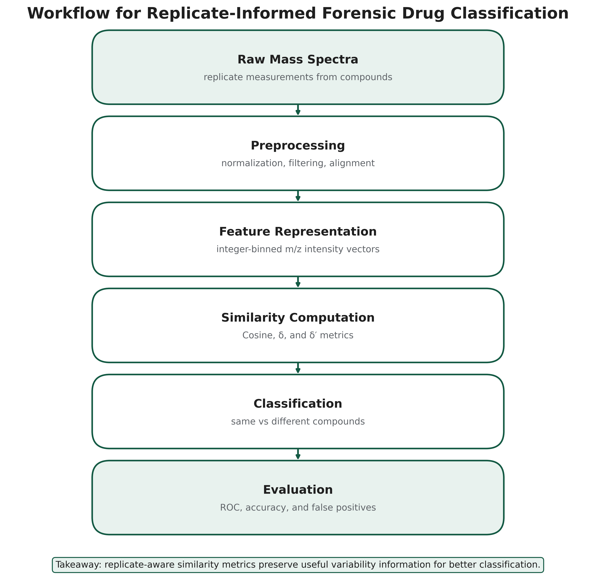
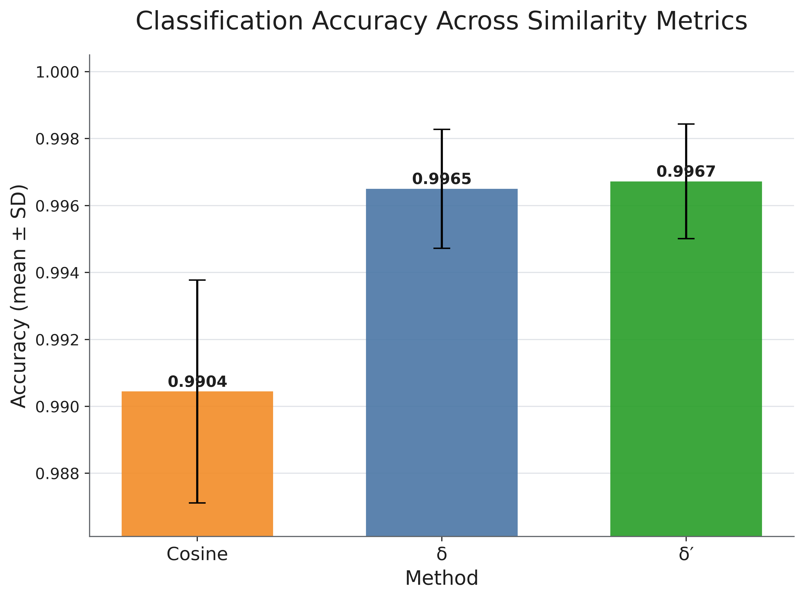
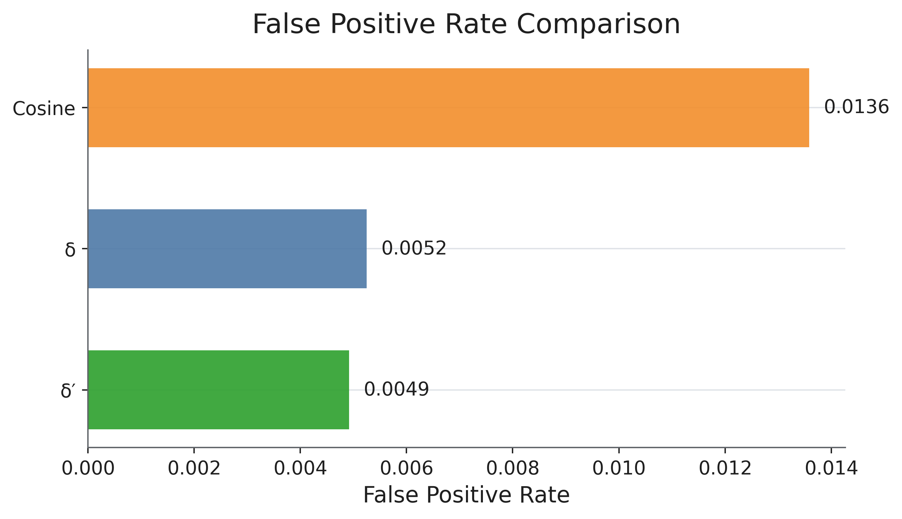

# Mass Spectra Classification | Replicate-Informed Statistical Analysis

**Collaborative MSc research project — April 2026**  
**Researchers:** Nhen Way and Fatema Naoshin  
**Research context:** Big Data Financial Analytics, Trent University  
**Tools:** Python · NumPy · pandas · Matplotlib · statistical evaluation · data preprocessing

> **Scope of results:** This is an academic research and analytics portfolio, not a validated forensic diagnostic tool. All accuracy and false-positive results below were obtained after selecting thresholds on the **same comparisons used for evaluation**. They represent **within-run optimized performance**, not performance on an independent held-out test set.

## Project overview

Electron-ionization mass spectra provide a chemical fingerprint but can differ slightly across repeated measurements of the same compound. The research question was whether using *replicate-to-replicate variation* produces more reliable same-versus-different compound decisions than a conventional cosine-similarity score.

We compared three scoring approaches:

1. **Cosine similarity:** a maximum pairwise cosine-similarity baseline.
2. **Standard min–max statistic (δ):** compares conservative within-group similarity against between-group similarity.
3. **Robust min–max statistic (δ′):** substitutes the 10th-percentile within-group and 90th-percentile between-group cosine similarities to reduce sensitivity to extreme replicate scores.

The **δ′ notation here denotes our project's quantile-based implementation**; it is not identical to the transformed δ′ score defined in the original Moorthy and Sisco (2021) publication.

## Dataset and experimental design

| Attribute | Configuration |
|---|---|
| Data | 1,500 electron-ionization spectra from 150 compounds |
| Replicates | 10 spectra per compound |
| Subgroups | CM1: 28 compounds; CM2: 58; CM3: 49; Isomers: 15 |
| Spectral representation | Nominal integer m/z bins from 40 to 500, inclusive |
| Preprocessing | Positive-intensity filtering, integer mass rounding, maximum intensity per bin, base-peak normalization |
| Each randomized run | 300 same-compound, 300 cross-family different-compound and 300 within-family different-compound comparisons |
| Evaluation | 20 randomized runs, with a decision threshold selected separately within each run |
| Threshold objective | Maximize true-positive rate minus false-positive rate (Youden's J) |



## Results

The supplied project code and dataset reproduce these **averages across the 20 evaluation runs** (rounded below):

| Method | Mean accuracy | Mean false-positive rate |
|---|---:|---:|
| Cosine similarity | 99.04% | 1.36% |
| Standard min–max (δ) | 99.65% | 0.53% |
| Robust min–max (δ′) | 99.67% | 0.49% |





**Interpretation.** In the project's evaluation, both replicate-informed scores had higher accuracy and lower false-positive rates than the cosine baseline. The numerical difference between δ and δ′ was small; the results should not be interpreted as conclusive evidence that the quantile variant generalizes better.

### Important limitations

- **No held-out validation:** Each method's threshold was optimized and assessed on the same sampled comparisons. This can make performance estimates optimistic.
- **Shared underlying spectra:** Randomized runs reuse the same collection of compounds, so they are not equivalent to 20 independent external tests.
- **Restricted spectral window:** Only the m/z 40–500 range was analyzed.
- **Replicate requirement:** The methods assume repeated measurements are available for each specimen or comparison group.
- **Limited generalizability:** The results have not been established on independent instruments, laboratories or unknown compound sets.
- **ROC reporting:** The original saved ROC image was not included in this portfolio draft because its displayed AUC values did not match fresh calculations from the supplied comparison file using the current plotting code. The methods and figures should be reconciled before publishing an ROC/AUC claim.

The study compares **statistical similarity methods**, not a trained deep-learning classifier or a production-ready predictive system.

## Technical workflow

1. Load CSV peak lists for CM1, CM2, CM3 and Isomers.
2. Convert spectra into aligned numerical vectors using the same m/z range and normalization.
3. Generate same-compound, within-family, and cross-family comparisons of replicate subsets.
4. Calculate cosine similarity, δ and quantile-based δ′ for each comparison.
5. Search candidate classification thresholds and calculate accuracy, TPR, and FPR.
6. Repeat with 20 random seeds and summarize the distribution of results.
7. Create research figures and interpret methodological constraints.

**Python files:** `main.py` implements preprocessing, pair generation and evaluation. `plots.py` creates the output figures. The implementations are shared here in their uploaded form, rather than rewritten to produce stronger claims.

## Repository contents

```text
.
├── README.md
├── main.py
├── plots.py
├── requirements.txt
├── DATA_ACCESS.md
├── CONTRIBUTORS.md
├── .gitignore
├── results/
│   ├── summary_by_seed.csv
│   └── summary_stats.csv
└── figures/
    ├── accuracy.png
    ├── false_positive.png
    ├── workflow_flowchart.png
    └── figure_3_thresholds.png
```

## Reproducing the experiment

**Data are not bundled.** The original raw spectra may be subject to third-party rights. Obtain and use them only with appropriate authorization and follow [DATA_ACCESS.md](DATA_ACCESS.md).

With authorized raw CSV files, install Python 3.10+ and use:

```bash
python -m pip install -r requirements.txt
python main.py
```

Place the four source folders alongside `main.py`:

```text
CM1/       # peak-list CSV files
CM2/
CM3/
Isomers/
main.py
plots.py
```

Running `main.py` recreates an untracked local `results/` folder, including the detailed comparisons and graphics, if the source data are available. The checked-in summary tables document the runs supplied with this project.

## Research credit and authorship

**Joint academic project:** This collaborative MSc research project was completed by Nhen Way and Fatema Naoshin at Trent University in April 2026. The project is shared with the agreement of both researchers, with joint authorship acknowledged.

**Prior scientific method:** The min–max approach is based on Moorthy, A. S., and Sisco, E. (2021), *The min-max test: An objective method for discriminating between mass spectra* (full reference in the course paper). The quantile-based implementation is the student project's evaluated variant and should not be confused with the original authors' transformed score notation.

The project code and results were provided as user-supplied academic work. Data origin and redistribution terms have **not been verified**, so this repository excludes raw CSV data, the original report, and the co-authored academic poster. No open-source license is asserted.

## Transferable analytical skills

The work showcases data cleaning and vectorization, statistical decision thresholds, controlled numerical experiments, error-rate analysis, visualization and evidence-based documentation. These skills transfer to data analysis and model-validation responsibilities, though the application area here is forensic science rather than finance.
